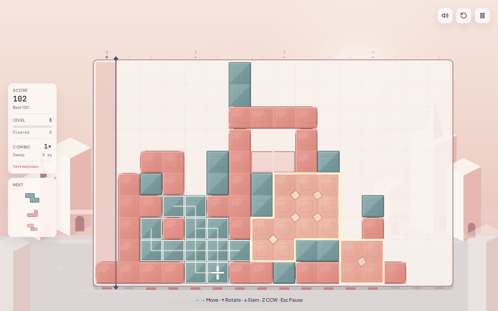
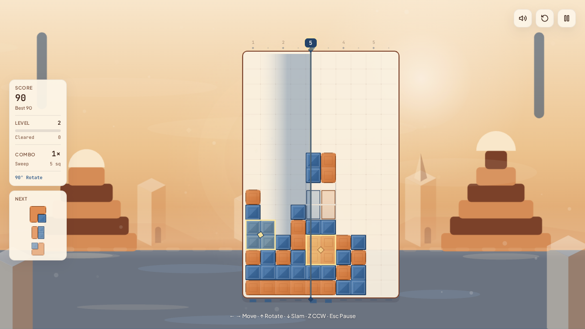
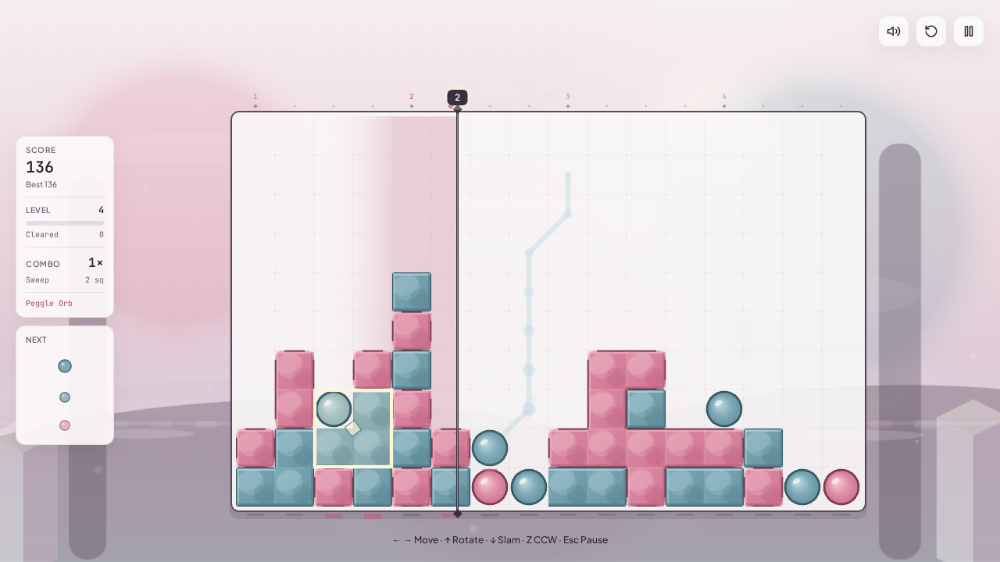
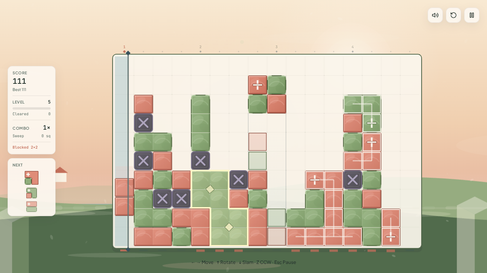
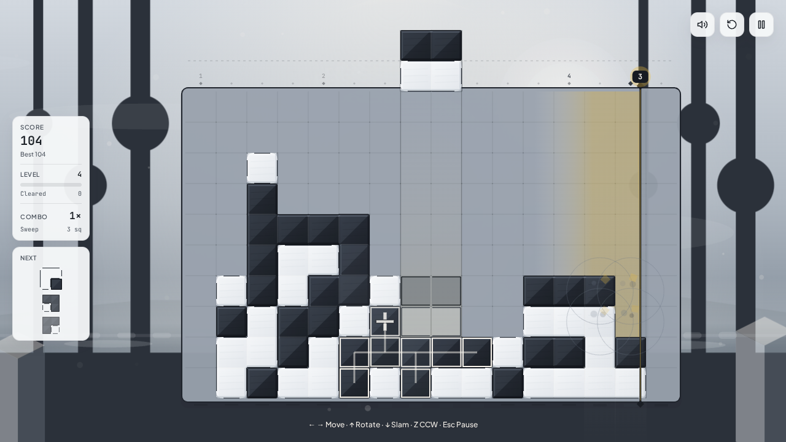
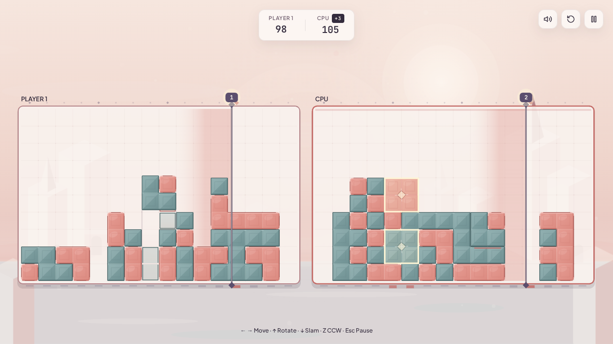

# Iluminado

A block game inspired by Lumines, but the game randomly changes as you play it. 

## Shifts

*Shift*: A small, targeted transformation to the tiles, board, orientation and other rules of the game. 

Shifts introduce temporary twists—like rotated boards, new tile shapes, obstacles, or altered sweep lines to keep runs unpredictable.

For example, you are playing and all the sudden after a level the tiles become tetris blocks instead of the normal 2x2. That's a shift bro. 

### How It Started

I found my old PS Vita and gave it to my son. Lumines. All these countless hours playing that flooded my head. ( Btw Lumines Remastered is great if you want a modern alternative ). 

So when I found out about the theme of the Github Game Off, my brain immediately went into how I could make Lumines as my basis and build a fun different game from it. 

My first idea was: what if the same board played like Tetris when held vertically, and Lumines when held horizontally? In practice, it didn't really work. It felt a bit clunky, and the two styles didn't quite translate back and forth on the same board.

###  The First Shift

The next idea was to just introduce random rotations—and that ended up becoming the first shift. Switching between vertical and horizontal was fun at first, though after a while, doing only rotations started to feel a bit stale.

###  Inspiration from Old Handhelds

My dad used to have a little import store in Central America, and one of the products that came through was those little handheld Tetris games that had 6 or 7 extra, fancy shapes on top of the standard ones. It shifted the way that Tetris was played by adding more blocks. 

Remembering that made me wonder: what if we took the standard 2x2 Lumines tiles and transformed them? Turning them into 2x1 or 3x2 combos, Tetris shapes, or ideas borrowed from Dr. Mario and Puzzle Fighter.

###  Expanding the Idea

Once tile shapes were on the table, it opened up the idea for other kinds of shifts:

* Board shifts: Changing the board dimensions or rotating the playfield.
* Tile shifts: Introducing non-standard shapes and combo blocks.
* Obstacles: Placing blocks or barriers to work around.
* Line shifts: Changing the way the sweep line moves across the board.

I added a few of these into the game and found they were genuinely fun. They bring an element of surprise to a run while keeping all the engaging parts of Lumines that made me want to build this in the first place.

### Shifts in Action

Whenever you level up (outside Puzzle mode), one active shift triggers for the new stage—rotating the playfield, reshaping the floor, swapping rows, or altering piece geometry and rules. Open **Shifts** from the title screen to toggle individual shifts or load category presets.

| Tetromino Bricks (`brick_tetromino`) | 90° Board Rotate (`rotate_90`) |
| :---: | :---: |
|  |  |
| Classic 4-tile I, O, T, S, Z, J, L tetrominoes drop into the courtyard. | Turns the playfield 90° into a tall 10×16 vertical shaft and drops stacks to the new floor. |

| Peggle Bounce Orb (`brick_peggle`) | Obsidian Blocked Bricks (`brick_blocked`) |
| :---: | :---: |
|  |  |
| Incoming pieces become single orbs that ricochet off blocks and walls on their way down. | Mixes dark obsidian blocker tiles into falling 2×2 pieces; they shatter beside cleared squares. |

### All 43 Shifts

#### Core & Dimension Shifts (9)
1. **90° Board Rotate** (`rotate_90`): Turns the entire playfield 90° clockwise or counter-clockwise and drops stacks to the new floor.
2. **Expand / Contract (±2)** (`board_resize`): Grows or shrinks board width and height by up to 2 blocks while preserving your stacks.
3. **Monochrome Line / Diagonal** (`line_color_shift`): Converts a single horizontal row, vertical column, or diagonal line into one uniform color.
4. **Directional Gravity Flow** (`flow_direction`): Shifts gravity and piece entry to arrive from the left, right, or bottom edge instead of the top.
5. **Cyclotron Gravity Orbit** (`cyclotron_flow`): Gravity orbits 90° clockwise after every dropped piece—top to right, bottom, left, and back.
6. **Portal Edge Wrap** (`portal_wrap`): Opens dimensional edges so steering past the left or right wall warps your piece to the opposite side.
7. **Reverse Timeline Sweep** (`reverse_sweep`): Flips the beat-locked timeline beam to sweep from right to left across the playfield.
8. **Split-Half Timeline** (`split_half_sweep`): Splits the sweep bar horizontally at mid-screen so the top and bottom halves clear 4 beats apart.
9. **Diagonal Slant Line** (`diagonal_slant_sweep`): Tilts the timeline sweep into a diagonal slash so upper rows clear ahead of lower rows.

#### Size & Silhouette Reshapes (8)
10. **The Split Canyon** (`split_canyon`): Cracks stacks left and right to carve an impassable 2-block-wide stone chasm down the center.
11. **Hourglass / Funnel Walls** (`hourglass_funnel`): Steps neutral side bumpers inward by 1–2 blocks across middle or lower rows.
12. **Twin Elevators** (`twin_elevators`): Lifts the left half up +2 blocks and lowers the right stage by 1 block into an asymmetric step.
13. **Rolling Wave Floor** (`rolling_wave_floor`): Undulates the stone floor into a +0 to +2 sine wave, lifting stacks into rolling hills.
14. **Octagon Cutoffs** (`octagon_cutoffs`): Locks stepped neutral stone blocks into all four corners to form an octagonal playfield.
15. **Staircase Terraces** (`staircase_terraces`): Sculpts symmetrical 1–2–3 stone steps rising along both wings, funneling stacks toward the center.
16. **Twin-Basin Center Spire** (`center_spire`): Raises a central stone monolith in the middle two columns to split play into twin flanking basins.
17. **Central Dome Pedestal** (`dome_pedestal`): Lifts the center four columns into a vaulted arched mound while keeping outer valleys deep.

#### Obstacles & Multi-Story Mechanics (10)
18. **Floating Mid-Air Shelf** (`floating_shelf`): Spawns a solid horizontal girder mid-air, turning the board into a two-story bunker.
19. **Castle Battlements** (`castle_battlements`): Raises 2-block neutral stone pillars every 3rd column from the floor to form narrow trenches.
20. **Patrolling 2×2 Bumper** (`patrolling_bumper`): Suspends a metallic 2×2 obstacle mid-air that slides left and right on the beat.
21. **Corner Bastion (4×4)** (`corner_edge_block`): Seals a compact 4×4 stone bastion in one lower corner once per run while keeping main drop lanes open.
22. **Bottom Plinth (4×3)** (`bottom_edge_block`): Raises a low stone plinth along the bottom edge once per run without blocking central drops.
23. **Side Margin Ledge (3×4)** (`side_edge_ledge`): Places a stepped stone margin along the left or right wall once per run to narrow the wing gently.
24. **Springboard Floor** (`spring_bounce`): Mounts amber trampoline pads along the floor that bounce incoming pieces skyward before locking.
25. **Belt Conveyor Floor** (`conveyor_floor`): Drives a motorized track along the bottom row, shifting settled floor blocks one column every 2 beats.
26. **Dual Twin Timeline** (`twin_sweep`): Splits the timeline into two synchronized beams sweeping 4 beats apart for double-tempo clears.
27. **Crumble Crystal Ledges** (`crumble_blocks`): Suspends brittle crystal ledges mid-board; two impacts or adjacent clears crack and shatter them.

#### Brick Shapes & 3-Color Shifts (10)
28. **2×1 / 1×2 Domino Bricks** (`brick_2x1`): Transforms incoming falling pieces into nimble 2×1 / 1×2 domino bricks for one turn.
29. **1×3 / 3×1 Trio Bricks** (`brick_3x1`): Transforms incoming falling pieces into linear 1×3 and 3×1 trio bricks for one turn.
30. **3×2 / 2×3 Slab Bricks** (`brick_3x2`): Transforms incoming falling pieces into wide 3×2 / 2×3 six-tile slabs for one turn.
31. **Tetromino Bricks** (`brick_tetromino`): Transforms incoming falling pieces into classic 4-tile I, O, T, S, Z, J, L shapes for one turn.
32. **Obsidian Blocked Bricks** (`brick_blocked`): Mixes a solid dark obsidian block into occasional 2×2 pieces for one turn; shatters beside clears.
33. **Peggle Bounce Orb** (`brick_peggle`): Turns incoming pieces into single bouncing orbs that ricochet randomly off blocks and walls for one turn.
34. **3-Color Spectrum** (`three_color_mode`): Introduces a third block color onto the board and incoming queue for one turn.
35. **3-Tile Corner L-Bricks** (`brick_l_trio`): Carves incoming pieces into crisp 3-tile L-trominoes with a missing corner pocket for interlocking fits.
36. **Chameleon Rotate** (`chameleon_rotate`): Rotating a falling brick cycles every tile color forward, letting you paint matches mid-air.
37. **Prism Wild Bricks** (`prism_wild_bricks`): Embeds achromatic diamond Prism Wild tiles into incoming 2×2 bricks that match any adjacent color.

#### Dramatic Row & Column Swaps (6)
38. **Inside-Out Swap** (`inside_out_swap`): Swaps outer columns with inner columns, flipping a central mountain into twin outer cliffs.
39. **Sawtooth Shear** (`sawtooth_shear`): Juts even rows right and odd rows left to transform straight walls into jagged zigzag teeth.
40. **Horizon Shear** (`horizon_shear`): Cuts a glowing fault seam across the stack, sliding upper rows right and lower rows left.
41. **The Zipper Merge** (`zipper_merge`): Interleaves top and bottom occupied rows cleanly like a zipper while keeping exact color ratios.
42. **Mirror Symmetry Flip** (`mirror_flip`): Reflects the entire occupied board horizontally across the center line in a crisp specular flip.
43. **Orbital Vortex Swirl** (`vortex_swirl`): Rotates occupied blocks clockwise around concentric perimeter rings like a slow architectural whirlpool.

## Skins and Music

The first cut of this was - hey, take Monument Valley and throw that into Lumines to make it look like that. It worked surprisingly well. I asked it to make the skins a little bit more art inspired and fun.

The music here reflects my pretty terrible musical taste. I wanted tracks I could listen to while playing this in my car. They are generated using the free Lyria that is included in Google Gemini. 

Basically I would come up with an idea or have AI suggest one that is different than the rest of the game. Something like:

```Desert Psychedelic Danzón

Identity: Elegant Latin ballroom rhythm, desert psychedelia, organic downtempo electronica.
Musical specification: 112 BPM · A Minor · 4/4 · Refined syncopated danzón-inspired pulse.

Full-track Lyria prompt

An elegant, hypnotic dance fusion combining the measured grace of danzón with desert psychedelia and deep electronic production. Deliberate bass pulses anchor the rhythm while brushed timbales, claves, and restrained hand percussion establish intricate ballroom movement. Warm electric piano, nylon-string guitar, and subtle piano montuno fragments create a sophisticated harmonic foundation. Psychedelic slide guitar and breathy flute phrases drift through expansive analog delays. Mysterious, romantic, and ceremonial, with beautiful melodic bends, long instrumental conversations, and spacious production. Avoid conventional salsa arrangements.

4-Stem Prompts
* Percussion: 112 BPM, A Minor. Restrained danzón pulse, timbales, claves, brushed snare, soft shaker, minimal fills.
* Bass: Warm electric bass, occasional sub reinforcement, A1, F1, G1, E1, controlled syncopation.
* Lead / Harmony: Nylon guitar, soft piano montuno fragments, psychedelic slide guitar, breathy flute, extended minor-7 and suspended chords.
* Vocal / Atmosphere: Wordless humming, desert wind textures, long analog delays, distant choral harmonics.
```

I paste this into Google Gemini and say Generate a track. Then I download the MP3. 

Once I upload the mp3 into the project, I ask AI studio to build a skin that is different than the other ones but inspired by the music, I usually also give it a visual reference that I love like cubist art that is a little more illustration and with a Neo Andean vibe. 

Each of the 40 worlds pairs its own architectural or artistic backdrop, themed board border, block textures, and 4-stem reactive mix (Percussion, Bass, Lead, and Atmosphere)—ranging from sumi-e ink wash, cubist collage, Neo-Andean *cholets*, 80s chrome sci-fi, Miami sunset neon, and animated cat sketchbooks to high-contrast monochrome worlds like **Silver Clearing**:




## Is this AI written?

Sadly yes. I would have loved to build this game with simply pure hand written code but it really started as a way to try to play Lumines in my browser. I wanted to explore how far the free AI Studio from Google and Hydrogen could take a game idea for free. I explored Google Playground but that didn’t go very far. It’s amazingly shocking what you can build with AI for free nowadays. 

## Game Modes

- **Challenge** (`Basic` / `Endless` / `Shuffle` / `Zen Flow`): Journey across all 40 worlds (`Basic`), loop endlessly (`Endless`), shuffle the world deck (`Shuffle`), or play continuously with top-overflow trimming in no-loss `Zen Flow`.
- **Daily Challenge**: Deterministic daily courtyard seed and mission shared by date, with countdown timer and streak tracking.
- **Time Attack** (`1 min` / `3 min` / `5 min`): High-tempo score race with live Personal Best (`vs PB`) split pace tracking.
- **Puzzle** (6 Levels): Build target silhouettes (*Pastel Archway*, *Sunlit Obelisk*, *Sand Hourglass*, *Monument Crown*, *Ascending Steps*, *Compass Sanctuary*) before the timer expires.
- **Mission** (6 Trials): Complete tactical clearing challenges (*Fourfold Resonance*, *Double Harmonic*, *Chain Sanctuary*, *Clean Slate*, *Monochrome Calm*, *Grand Sweep*).
- **VS CPU** & **2P Battle**: Side-by-side twin-board duels where big clears queue counter-playable garbage onto your rival's next sweep.



## Controls & Rules

up down left right. Up rotates, down slams, left and right move the blocks.

### Keyboard Controls

| Action | Single Player / VS CPU | 2P Battle — Player 1 | 2P Battle — Player 2 |
| --- | --- | --- | --- |
| Move Left / Right | `←` / `→` or `A` / `D` | `A` / `D` | `←` / `→` |
| Rotate Clockwise | `↑`, `W`, `Space`, or `X` | `W` | `↑` |
| Rotate Counter-CW | `Z` | `Q` | — |
| Slam (Hard Drop) | `↓`, `S`, `C`, or `Shift` | `S` or `Left Shift` | `↓`, `Right Shift`, or `/` |
| Pause / Restart / Mute | `P` or `Esc` / `R` / `M` | `P` or `Esc` / `R` / `M` | `P` or `Esc` / `R` / `M` |

On compact mobile screens, on-screen Left/Right, Rotate, and Slam buttons appear automatically.

### Partial Overflow & Game Over Rule

- If a locked piece only partially fits inside the board—for example, `1×2` or `1×1` of a `2×2` block descends past the top line while the remaining tiles stick out above—the portion that fits settles onto the board, the overhanging tiles are discarded, and play keeps going.
- **Game Over** triggers **only when 0 cells** of a locked piece can enter the board (except in **Zen Flow**, which gently trims overflow so runs continue).

## Development

```bash
npm install
npm run dev       # Starts Vite dev server on http://localhost:3000
npx tsx --test src/game/engine.test.ts
npm run lint
npm run build
```

