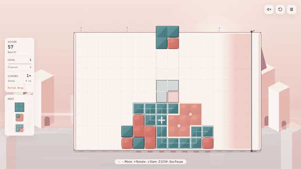
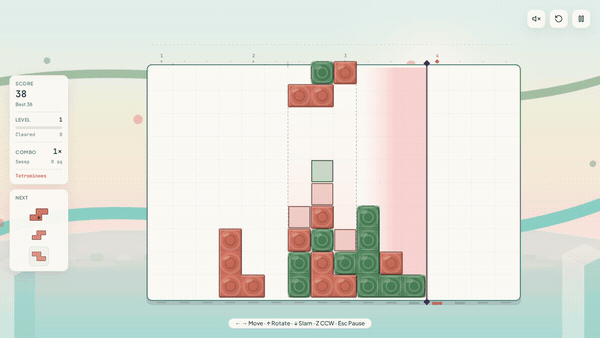
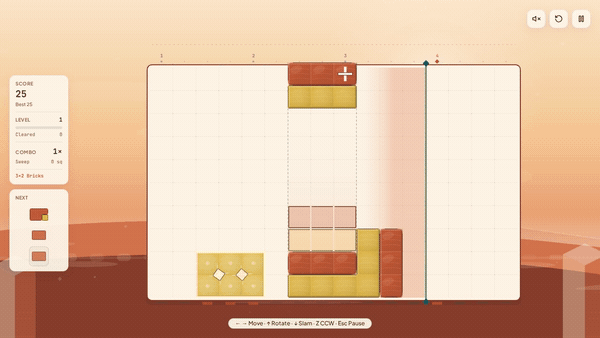

# Iluminado — itch.io Storefront Copy & Dashboard Setup

Paste the metadata fields and formatted HTML/Markdown description below directly into **Dashboard -> Edit Game** on itch.io.

---

## 1. Dashboard Metadata Fields

| Field | Value |
| :--- | :--- |
| **Title** | `Iluminado` |
| **Short description / Tagline** | `Drop on the beat. Align 2×2 squares. Outlast 52 rule-bending shifts across 50 genre-fusion worlds.` |
| **Classification** | `Games` |
| **Kind of project** | `HTML` (Play in browser) |
| **Embed size** | `1280 × 720` (Desktop 16:9) · Also responds cleanly in mobile Portrait (`10×14`) |
| **Embed options** | Enable **Click to play** (required so the browser unlocks Web Audio cleanly), **Fullscreen button**, and **Mobile friendly** |
| **Genre** | `Puzzle` |
| **Tags** | `lumines, rhythm, falling-blocks, puzzle, music, arcade, score-attack, daily-challenge, local-multiplayer, two-player, browser, html5, pwa` |

---

## 2. Media Uploads Checklist (`https://youtu.be/BUGGmayKcXU`)

| itch.io Slot | File / URL | Spec |
| :--- | :--- | :--- |
| **Video URL / Trailer** | `https://youtu.be/BUGGmayKcXU` | Auto-docks first in the itch carousel |
| **Cover Image** | `itch/media/cover.png` | `1260 × 1000 px` (exact 1.26:1 ratio) |
| **Theme -> Header Banner** | `itch/media/header-banner.png` | `1200 × 360 px` panoramic banner |
| **Screenshots (5 recommended)** | `itch/media/screenshots/01-core-rhythm-flow.png`<br>`itch/media/screenshots/02-tetromino-shift.png`<br>`itch/media/screenshots/03-split-canyon-shift.png`<br>`itch/media/screenshots/04-splitscreen-versus.png`<br>`itch/media/screenshots/05-52-shifts-codex.png` | `1280 × 720 px` lossless PNG |
| **Description Body GIFs (3 recommended)** | `itch/media/clips/clip-01-beat-sweep-combo.gif`<br>`itch/media/clips/clip-02-tetromino-shift.gif`<br>`itch/media/clips/clip-03-slab-bricks-shift.gif` | `600 × 338 px` looping GIF (`1.7–2.2 MB`, under itch's 3MB limit) |

---

## 3. Page Description (Ready to Copy & Paste into itch.io)

> **Tip**: After pasting into itch.io's description editor, upload the three GIFs from `itch/media/clips/` via the **Insert Image** button so itch hosts them on its CDN in those three visual slots.

```html
<blockquote>
  What if your favorite beat-matching brick dropper rewrote its own rules every time you leveled up?
</blockquote>

<p>
  <strong>Iluminado</strong> takes the hypnotic 2×2 rhythm-sweep flow inspired by <em>Lumines</em> and turns the playfield into a living, shifting instrument. Drop dual-color bricks, build glowing single-color squares, and let the tempo-locked timeline beam sweep them away in bursts of score multipliers.
</p>

<p>
  Just when your hands find a groove, a <strong>Shift</strong> fires—warping brick shapes, rotating the entire board 90°, splitting the timeline in half, or turning gravity sideways.
</p>

<p>
  <strong><a href="https://youtu.be/BUGGmayKcXU" target="_blank" rel="noopener noreferrer">▶ Watch the Full Gameplay Trailer on YouTube</a></strong>
</p>

<p align="center">
  <!-- Replace src with uploaded clip-01-beat-sweep-combo.gif -->
  
</p>

<h2>52 Shifts That Rewrite the Game</h2>
<p>
  No two runs stay polite for long. Every level triggers a curated rule mutation from a catalog of <strong>52 playable Shifts</strong>—or open the <strong>Board Shift Rules</strong> codex before starting to customize your favorite mix.
</p>

<div class="ilu-grid-2">
  <div class="ilu-card">
    <span class="ilu-tag ilu-tag-coral">Brick Mutations</span>
    <p>Swap standard 2×2 blocks for classic <strong>Tetrominoes</strong> (I, O, T, S, Z, J, L), nimble <strong>2×1 Dominoes</strong>, heavy <strong>3×2 Slabs</strong>, <strong>Chameleon Rotation</strong>, or chained <strong>Wild Prism</strong> tiles.</p>
  </div>
  <div class="ilu-card">
    <span class="ilu-tag ilu-tag-violet">Gravity &amp; Geometry</span>
    <p>Spin the entire courtyard <strong>90° mid-run</strong> into a tall vertical shaft, expand or shrink the grid, carve a <strong>Split Canyon</strong> chasm, or face <strong>Cyclotron Orbit</strong> gravity rotating clockwise every drop.</p>
  </div>
  <div class="ilu-card">
    <span class="ilu-tag ilu-tag-teal">Timeline Remixes</span>
    <p>Reverse the sweep beam's direction, split it into staggered <strong>Top &amp; Bottom Half-Sweeps</strong>, tilt it into a <strong>Diagonal Slant</strong>, or illuminate blocks with a roving <strong>Lantern Spotlight</strong>.</p>
  </div>
  <div class="ilu-card">
    <span class="ilu-tag ilu-tag-saffron">Spectrum &amp; Obstacles</span>
    <p>Unlock a <strong>3rd Block Color</strong> mid-run, break <strong>Obsidian Blocker</strong> cells by clearing beside them, bank pieces with <strong>Hold / Stash</strong>, or dodge mid-air <strong>Patrolling Bumpers</strong>.</p>
  </div>
</div>

<p align="center">
  <!-- Replace src with uploaded clip-02-tetromino-shift.gif -->
  
</p>

<h2>50 Worlds, 50 Genre-Fusion Soundtracks</h2>
<p>
  Every stage opens onto an illustrated world with its own tactile tile material, particle geometry, color spectrum, and an original full-length soundtrack built around bold futuristic genre crossovers—from <em>Glass Zouk × Choral IDM × Dub</em> and <em>Clockwork Swing × Glitch × Gamelan</em> to <em>Liquid Bachata × Vapor × Cello</em> and <em>Harlequin Glitch × Swing × Acid-Pop</em>.
</p>

<ul>
  <li><strong>Quantized Musical Feedback</strong> — Steering, rotating, landing, and chain clears trigger harmonic chimes locked in key with each world's tempo and scale.</li>
  <li><strong>Visual Rhythm Telemetry</strong> — Subtle architectural motion, sweep glow, and score popups pulse right on the measure without distracting HUD clutter.</li>
</ul>

<p align="center">
  <!-- Replace src with uploaded clip-03-slab-bricks-shift.gif -->
  
</p>

<h2>7 Distinct Modes</h2>
<table>
  <thead>
    <tr>
      <th>Mode</th>
      <th>What Awaits</th>
    </tr>
  </thead>
  <tbody>
    <tr>
      <td><strong>Challenge</strong></td>
      <td>Journey across worlds as Shifts stack on every level—play <em>Basic</em>, <em>Endless</em>, <em>Shuffle</em>, or pressure-free <em>Zen Flow</em>.</td>
    </tr>
    <tr>
      <td><strong>Daily Challenge</strong></td>
      <td>A deterministic world and Shift sequence generated fresh every 24 hours so everyone races the same board.</td>
    </tr>
    <tr>
      <td><strong>Time Attack</strong></td>
      <td><strong>60s</strong>, <strong>180s</strong>, or <strong>300s</strong> pure clear sprints with split-pace tracking.</td>
    </tr>
    <tr>
      <td><strong>Puzzle</strong></td>
      <td>Sculpt deliberate silhouettes—like <em>Pastel Archway</em>, <em>Sand Hourglass</em>, and <em>Monument Crown</em>—against the clock.</td>
    </tr>
    <tr>
      <td><strong>Mission</strong></td>
      <td>Tactical micro-challenges with preset stacks (4-square single sweeps, full board clears, monochrome leftovers).</td>
    </tr>
    <tr>
      <td><strong>VS CPU</strong></td>
      <td>Head-to-head duel against an adaptive AI solver—big clears launch garbage pressure across the center line.</td>
    </tr>
    <tr>
      <td><strong>2P Battle</strong></td>
      <td>Shared-screen local versus battle on one keyboard or browser window.</td>
    </tr>
  </tbody>
</table>

<h2>Controls</h2>
<table>
  <thead>
    <tr>
      <th>Action</th>
      <th>Solo Keyboard</th>
      <th>2P Battle (P1 / P2)</th>
      <th>Touch / Mobile</th>
    </tr>
  </thead>
  <tbody>
    <tr>
      <td><strong>Move Left / Right</strong></td>
      <td><kbd>←</kbd> <kbd>→</kbd> or <kbd>A</kbd> <kbd>D</kbd></td>
      <td><kbd>A</kbd> <kbd>D</kbd> &nbsp;/&nbsp; <kbd>←</kbd> <kbd>→</kbd></td>
      <td>Drag horizontally or tap arrow controls</td>
    </tr>
    <tr>
      <td><strong>Rotate CW / CCW</strong></td>
      <td><kbd>↑</kbd> <kbd>W</kbd> <kbd>Space</kbd> <kbd>X</kbd> &nbsp;/&nbsp; <kbd>Z</kbd></td>
      <td><kbd>W</kbd> <kbd>Q</kbd> &nbsp;/&nbsp; <kbd>↑</kbd></td>
      <td>Tap board or rotate buttons</td>
    </tr>
    <tr>
      <td><strong>Hard Drop / Slam</strong></td>
      <td><kbd>↓</kbd> <kbd>S</kbd> <kbd>C</kbd> <kbd>Shift</kbd></td>
      <td><kbd>S</kbd> <kbd>L-Shift</kbd> &nbsp;/&nbsp; <kbd>↓</kbd> <kbd>R-Shift</kbd> <kbd>/</kbd></td>
      <td>Swipe down or tap drop button</td>
    </tr>
    <tr>
      <td><strong>Hold / Stash Piece</strong></td>
      <td><kbd>C</kbd> or <kbd>Shift</kbd> <em>(when Stash Shift is active)</em></td>
      <td>—</td>
      <td>Tap Hold slot</td>
    </tr>
    <tr>
      <td><strong>Pause / Mute</strong></td>
      <td><kbd>Esc</kbd> or <kbd>P</kbd> &nbsp;·&nbsp; <kbd>M</kbd></td>
      <td><kbd>Esc</kbd> &nbsp;·&nbsp; <kbd>M</kbd></td>
      <td>Top-right Pause &amp; Sound icons</td>
    </tr>
  </tbody>
</table>

<p><em>Headphones recommended — built-in dynamic compressor &amp; quantized harmonic SFX respond cleanly on every beat. Plays smoothly in desktop landscape or mobile portrait right in your browser.</em></p>
```
